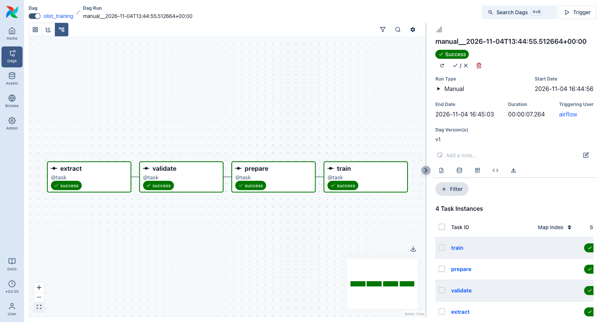
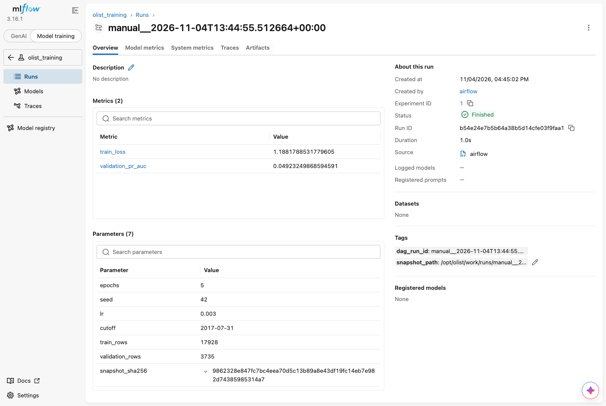

# Olist: пайплайн PostgreSQL → Airflow → MLflow

DAG `olist_training` раз в неделю выгружает заказы из PostgreSQL, проверяет снимок, делит его по времени и обучает модель опоздания доставки. Каждый запуск даёт отдельный run в MLflow с параметрами, метриками по эпохам и моделью. Тег `dag_run_id` ведёт к запуску Airflow, параметр `snapshot_sha256` — к снимку данных.

## Запуск

Нужны Git и Docker с Compose v2 (для Docker: 4 ГБ RAM, 2 CPU). Первая сборка образа ставит torch и занимает несколько минут.

```bash
git clone https://github.com/meowser52/practic_ml_Avito.git olist-homework
cd olist-homework
cp .env.example .env
docker compose up -d --build --wait    # ждёт, пока source, mlflow и airflow станут healthy
```

| Интерфейс | Адрес |
|---|---|
| Airflow | http://127.0.0.1:8080 |
| MLflow | http://127.0.0.1:5050 (вкладка Model training, эксперимент `olist_training`) |
| MLflow из контейнера Airflow | http://mlflow:5000 |

Порты опубликованы только на `127.0.0.1`.

Включить DAG и запустить обучение (то же самое — переключатель и Trigger в Airflow):

```bash
docker compose exec -T airflow airflow dags unpause olist_training
docker compose exec -T airflow airflow dags trigger olist_training
```

При включении Airflow сразу создаёт один плановый запуск за последнюю неделю (`catchup=False`, без догоняющих запусков с `start_date`). Ручной запуск ждёт его в очереди: активен только один запуск. Запуск занимает около 10 секунд.

Последние MLflow run и соответствующие запуски Airflow:

```bash
docker compose exec -T airflow python -c "import mlflow; r = mlflow.search_runs(experiment_names=['olist_training'], max_results=3); print(r[['run_id', 'tags.dag_run_id', 'status']].to_string(index=False))"
```

## Прогноз

Команда с MLflow run из моего окружения; в новом окружении подставьте `run_id`, созданный там:

```bash
docker compose exec -T airflow python -m check_model --run-id b54e24e7b5b64a38b5d14cfe03f9faa1
```

```json
{"run_id": "b54e24e7b5b64a38b5d14cfe03f9faa1", "rows": 5, "probabilities": [0.7106074094772339, 0.5012513399124146, 0.2709561884403229, 0.1435118466615677, 0.22757172584533691]}
```

## Этапы

У каждого запуска Airflow свой каталог в `/opt/olist/work/runs/`: `run_id` с заменой `:` и `+` на `_` и 8 символов SHA256 от `run_id`. Точный путь к снимку записан в теге `snapshot_path` MLflow run. Через XCom идут только пути, числа строк и SHA256.

- **extract** — `COPY` таблицы `public.orders` (13 столбцов, сортировка по времени покупки и `order_id`) в `snapshot.csv`. Повтор того же запуска атомарно перезаписывает файл, у другого запуска свой каталог, поэтому строки не копятся. При ошибке БД — 3 повтора через 30 секунд.
- **validate** — только чтение CSV: есть строки, все 13 столбцов без дублей, `order_id` заполнен и уникален, даты в ISO 8601, числа конечны, `late` равен 0 или 1, категории заполнены. Ошибка — `SnapshotValidationError` со списком нарушений; `retries=0`.
- **prepare** — SHA256 байтов снимка и `split_by_time` из `olist_model` по тем же байтам: train до `2017-07-31`, validation с этой даты. Пишет `train.csv` и `validation.csv`.
- **train** — `fit_model`; в MLflow параметры `epochs`, `seed`, `lr`, `cutoff`, `train_rows`, `validation_rows`, `snapshot_sha256`, метрики `train_loss` и `validation_pr_auc` по эпохам, теги `dag_run_id` и `snapshot_path`. Модель с преобразованиями сохраняется через `save_predictor` в `model/` и загружается в артефакт `model`.

DAG: `@weekly`, `catchup=False`, `max_active_runs=1`, таймаут у каждой задачи и у запуска (1 ч), `trigger_rule='all_success'` у validate, prepare и train. Параметры `epochs` и `seed` можно передать при запуске (Params или `-c '{"epochs": 3, "seed": 7}'`); пустые значения берутся из `OLIST_EPOCHS` и `OLIST_SEED`.

## Результаты проверок

| Сценарий | Результат |
|---|---|
| Два ручных запуска | оба success, MLflow run `b54e24e7…` и `5555c908…`; в каждом снимке 21 663 строки и одинаковый SHA256 `9862328e…` |
| Испорченная копия снимка с повтором `order_id` | validate failed: `order_id is not unique: 2 rows share ids (bfbd0f9b…)`; prepare и train — upstream_failed |
| Исключение в train, исправление, Clear только train | train success со 2-й попытки, MLflow run `b7a73049…`; extract, validate, prepare остались на 1-й попытке и не перезапускались |
| PostgreSQL остановлен во время extract | extract up_for_retry, после запуска БД — success со 2-й попытки |
| `docker compose restart` и пересоздание mlflow | прогноз по `b54e24e7…` совпал с прежним, метрики и артефакты на месте |
| Params `{"epochs": 3, "seed": 7}` | run `171afd8c…` с epochs=3, seed=7 и тремя точками метрик |

Метрики при 5 эпохах и seed 42 совпадают с `prototype.ipynb`: `validation_pr_auc` 0.0492 при доле опозданий в validation 0.0278.





## Перезапуск

```bash
docker compose restart
docker compose up -d --force-recreate --no-deps mlflow
```

После обеих команд история Airflow, run, метрики и модели MLflow сохраняются: SQLite и артефакты лежат в volume `mlflow-data`. `docker compose down` без `-v` тоже не трогает volumes.

## Файлы

| Файл | Что внутри |
|---|---|
| `src/olist_pipeline.py` | этапы extract, validate, prepare, train |
| `dags/olist_training.py` | DAG `olist_training` |
| `compose.yaml` | PostgreSQL, Airflow, MLflow (SQLite и артефакты в volume `mlflow-data` на `/mlflow`) |
| `Dockerfile`, `requirements.txt` | образ Airflow с закреплёнными версиями |
| `data/`, `src/olist_model.py`, `src/check_model.py` | выданные данные, модель и проверка без изменений |
| `docs/` | скриншоты |

Данные Olist распространяются по лицензии CC BY-NC-SA 4.0, см. `data/LICENSE.md`.
